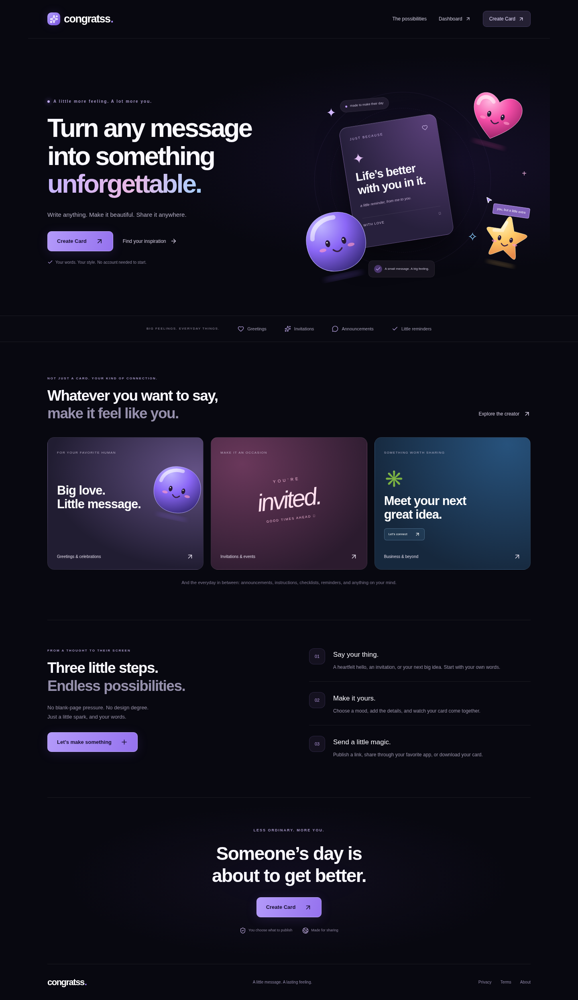
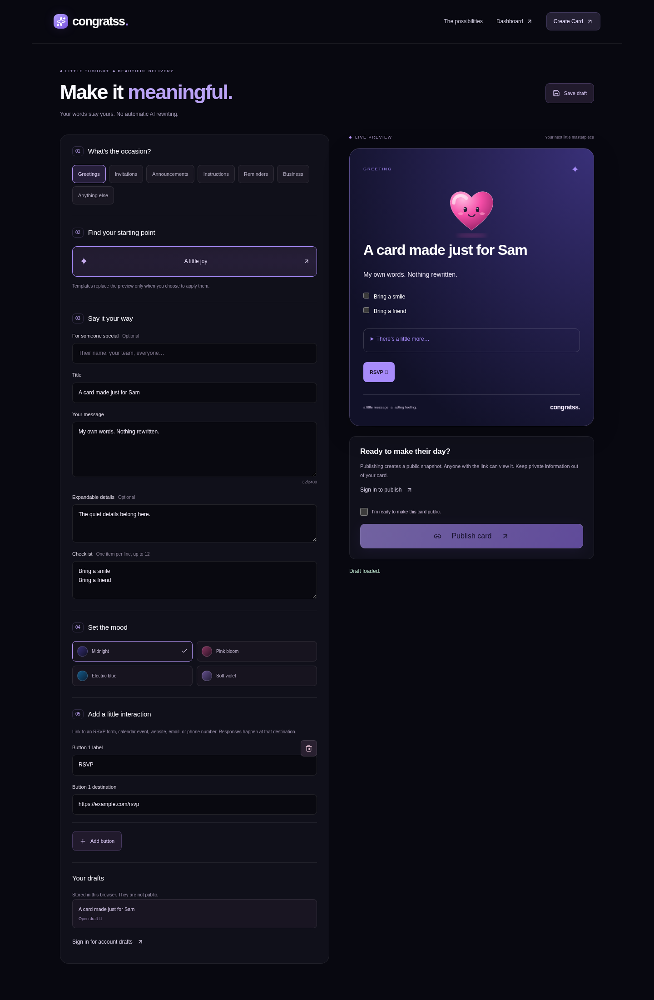
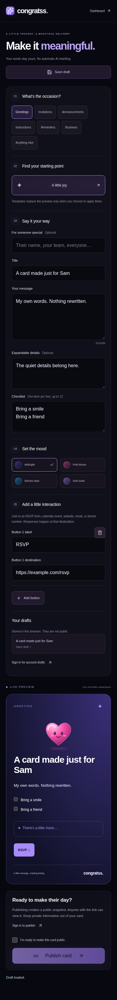
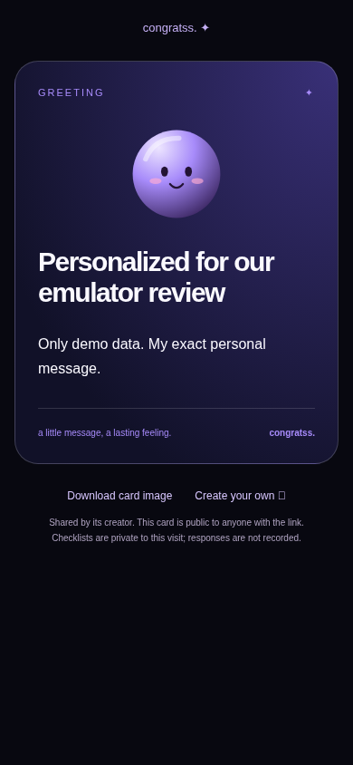

# Congratss 2.0 review notes

Base: `gratzz-zero` at `1840e562fb1a67410301afaf62c9eae5074b16d1`.
Branch: `feature/congratss-2-modernization`.

## Implementation

- Rules block privilege additions/removals using affectedKeys; trusted role records/custom claims and verified legacy email admins retain library permissions. Storage preserves public greeting_cards/user_uploads, denies unknown paths, restricts upload types/sizes and permits admin deletion. Scheduled destination edits now match the existing editor. User preferences, celebrations, schedules and drafts have validation.
- Patched production dependencies include Next.js 16.4.2, Sharp 0.35.5 and Capacitor 8.5.3 and Firebase 12.19.0 security updates. The Firestore SDK’s Node adapter uses an explicit same-major gRPC 1.14.6 override to address the SDK’s old transitive pin; emulator tests cover it. No native platform project regeneration or deployment was performed.
- Original glossy SVG characters (authored in source) and a responsive midnight homepage. No borrowed character artwork or runtime 3D dependency.
- Development now uses Next’s default Turbopack. The old Webpack override produced an invalid JavaScript bundle during an authenticated reload regression under the patched framework; the same regression passes with Turbopack. Firestore persistence uses the supported multi-tab cache API, and authentication readiness is independent of optional preference reads.
- Existing dashboard moved to /dashboard. Installed PWA/native entries remain dashboard-oriented. Authentication returns there, or to /create when requested. Old card viewer links are retained. Countdown data refreshes when the local day changes or the app regains focus.
- Seven-purpose composer, exact author message preservation, explicit template replacement, four themes, live preview, details/checklists/buttons, account/device drafts, explicit public consent.
- Independent authenticated publisher: schema validation, immutable snapshots, idempotent requests, transaction quotas, owner listing/revocation, HTML/OG rendering, personalized PNGs, and account cleanup.

## Screenshots

## Review gates / outstanding work

- No rules, services or frontend deployment has been performed. No live Firebase data was read or modified during development tests.
- Rules require dedicated security review and staging validation before any future rollout. Audit pre-existing admin role records for compromise; a rules fix does not revoke already assigned privileges. Inventory unknown Storage paths before the intentional default-read restriction is deployed. Existing public links under greeting_cards/user_uploads remain supported.
- Publisher deployment origin, IAM, infrastructure rate/concurrency controls, retention policy and actual platform preview caches need a separate staging/deployment task.
- The first 50 active publications are listed; full pagination is not included. Local drafts retain up to 20 copies; browser storage is not a backup. Account draft query returns up to 20 records.
- AI, billing, autonomous delivery, persisted RSVP responses and native feature upgrades are outside these approved phases. Links may point to external RSVP/calendar services; checklists remain local to each visit.
- Legacy scheduling still represents an app handoff rather than confirmed delivery. This change does not claim background delivery.
- Physical iOS/Android devices, iMessage/Messenger app behavior and App Store submissions remain unverified.

See [publishing service operations](../services/publisher/README.md) and [specification](../specs/002-congratss-modernization/spec.md).

## Dependency security

`npm audit --omit=dev` reports **zero vulnerabilities** after the patched runtime updates and same-major gRPC override. The full audit still reports **11 development-tool dependency entries** (7 high, 4 moderate), including inherited entries through Firebase CLI and Next's ESLint plugin. npm's proposed automatic remedies downgrade Firebase CLI/Next ESLint to earlier major versions; those forced downgrades were not applied. These toolchain advisories need compatible upstream remediation and are an explicit review item, not a claim that the whole development dependency tree is advisory-free.

## Public card artifacts

## Verified locally

| Check | Result |
| --- | --- |
| Frozen `npm ci` | Passed; unit/API tests rerun after the clean install |
| `npm run lint -- --max-warnings 0` | Passed, zero lint errors/warnings |
| `npm run test:unit` | 13 passed, zero failed/skipped |
| `npm run test:security` | 11 passed, zero failed/skipped, demo emulators only |
| `npm run test:e2e:emulators` | 7 passed, zero failed/skipped |
| `npm run build` | Passed, static export and TypeScript validation |
| `npm audit --omit=dev` | Zero reported vulnerabilities |

Browser coverage includes desktop/mobile screenshots, automated axe checks on the new homepage/creator, reduced motion, all seven purposes, explicit template application, user-authored content preservation, local/account draft reloads, genuine authenticated publishing and revocation, OG HTML, PNG downloads, legacy card links, sign-in redirects, calendar navigation, and legacy celebration create/edit/delete. Physical devices and real messaging apps are not represented by headless Chromium checks.
